<!-- GENERATED by scripts/build_profile.py. Edit config/profile.json instead. -->

<picture>
  <source media="(prefers-color-scheme: dark)" srcset="./assets/hero/banner-dark.svg">
  
</picture>

 

<strong>Full Stack | Data Platforms | Production LLM &amp; RAG Solutions | Agentic AI Development</strong>

<a href="https://github.com/orionstar65">GitHub</a>

### `01` &nbsp; A little about me

<picture>
  <source media="(prefers-color-scheme: dark)" srcset="./assets/sections/terminal-dark.svg">
  
</picture>

I design, build, and scale full-stack software — from polished user experiences to resilient services, intelligent workflows, and cloud infrastructure.

- **Currently exploring:** AI & Automation, Distributed Systems, Full-Stack Products.
- **How I work:** Design for clarity, Engineer for reliability, Automate thoughtfully.
- **What matters:** Clear interfaces, measured trade-offs, maintainable architecture, and dependable delivery.

### `02` &nbsp; Technology arsenal

<picture>
  <source media="(prefers-color-scheme: dark)" srcset="./assets/sections/stack-dark.svg">
  
</picture>

<strong>Expand the full stack as accessible text</strong>

- **Frontend:** TypeScript, React, Next.js, Tailwind CSS, Web UX
- **Backend:** Node.js, Python, Go, REST / GraphQL, PostgreSQL
- **Cloud &amp; Data:** AWS / GCP, Docker, Kubernetes, Redis / Kafka, CI/CD
- **AI &amp; Automation:** LLM Integrations, RAG Pipelines, Ollama, Playwright, AI Workflows

### `03` &nbsp; Selected work

<table>
<tr>
<td width="50%" valign="top">

<picture>
  <source media="(prefers-color-scheme: dark)" srcset="./assets/projects/roleward-dark.svg">
  
</picture>

<strong>Roleward</strong> · private project

Desktop automation, private AI inference, application tracking, and interview prep workflows.

</td>
<td width="50%" valign="top">

<picture>
  <source media="(prefers-color-scheme: dark)" srcset="./assets/projects/connectors-dark.svg">
  
</picture>

<strong>Enterprise Connectors</strong> · engineering experience

Integration services, content ingestion, API reliability, and retrieval-oriented systems.

</td>
</tr>
<tr>
<td width="50%" valign="top">

<picture>
  <source media="(prefers-color-scheme: dark)" srcset="./assets/projects/travel-dark.svg">
  
</picture>

<strong>Travel Platforms</strong> · engineering experience

Scalable backend services, real-time updates, orchestration, and resilient integrations.

</td>
<td width="50%" valign="top">

<picture>
  <source media="(prefers-color-scheme: dark)" srcset="./assets/projects/lab-dark.svg">
  
</picture>

<a href="https://github.com/orionstar65?tab=repositories"><strong>Engineering Lab ↗</strong></a>

Selected public repositories, engineering experiments, and useful tools.

</td>
</tr>
</table>

Selected work includes private projects and professional experience; public repositories are linked when available.

### `04` &nbsp; GitHub pulse

<picture>
  <source media="(prefers-color-scheme: dark)" srcset="./assets/generated/metrics-dark.svg">
  
</picture>

<picture>
  <source media="(prefers-color-scheme: dark)" srcset="./assets/generated/snake-dark.svg">
  
</picture>

GitHub activity reflects public data only.

### `05` &nbsp; Let’s connect

<picture>
  <source media="(prefers-color-scheme: dark)" srcset="./assets/sections/footer-dark.svg">
  
</picture>

<a href="https://github.com/orionstar65">GitHub</a>

